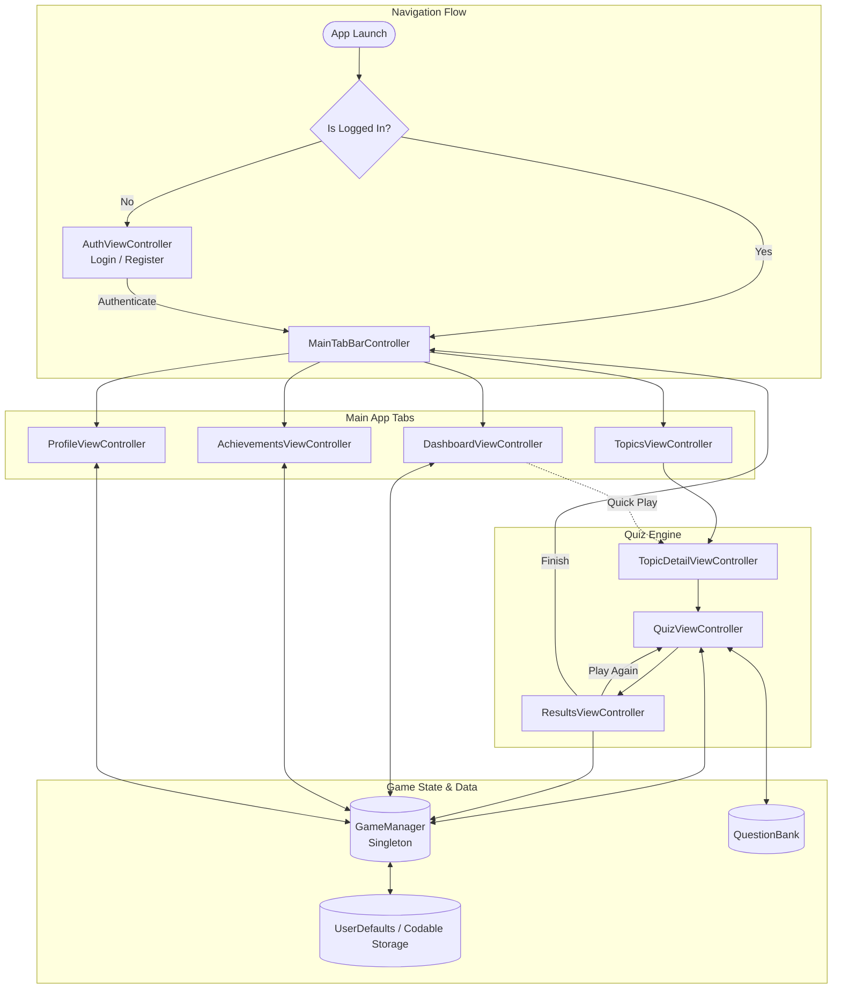

# ⚡ BrainRush — Quiz and Earn

<div align="center">


-6842FF?style=for-the-badge)


<br/>

**Quiz, learn, and earn.** Test your CS knowledge across Operating Systems, Networking, DBMS, Programming, and Architecture to rack up XP, maintain streaks, and unlock trophies.

[Features](#-cool-features) • [Progression Engine](#-rpg-style-progression-engine) • [Tech Stack](#-tech-stack--architecture) • [App Flow](#-application-architecture) • [Quick Start](#-quick-start)

---

</div>

## 🚀 Overview

**BrainRush** transforms technical interview prep and core computer science revision into an adrenaline-pumping, gamified experience. Built 100% programmatically in Swift with modern UIKit, it features slick physics-inspired card layouts, instant haptic-like answer feedback, adaptive difficulty tiers, and a local offline-first persistence engine.

---

## ✨ Cool Features

### 🧠 5 Core Computer Science Domains
Battle through curated question banks structured from foundational concepts to tricky edge cases:
- 💻 **Computer Basics**: Hardware internals, CPU pipelining hazards, cache hierarchies (L1/L2/L3), and volatile/non-volatile memory structures.
- ⚡ **Programming**: Language semantics (C, C++, Java), pointers, memory management, OOP paradigms, and algorithm logic.
- 🗄️ **DBMS**: Relational theory, SQL queries, normalization forms (1NF to BCNF), indexing, and ACID transaction semantics.
- 🌐 **Computer Networks**: OSI & TCP/IP stacks, subnetting, socket lifecycles, DNS, routing algorithms, and transport protocols.
- ⚙️ **Operating Systems**: Kernel vs. User space, CPU scheduling algorithms, virtual memory paging, multithreading, and deadlock prevention.

---

### 🎮 RPG-Style Progression Engine
Earn XP with every correct answer and climb through ranks as your knowledge sharpens:

| Tier | Level Bracket | Difficulty | XP / Correct Answer | Title |
|:---:|:---:|:---:|:---:|:---|
| 🟢 | **Levels 1 – 2** | Easy | **+10 XP** | **Rookie** |
| 🔵 | **Levels 3 – 4** | Medium | **+20 XP** | **Challenger** |
| 🟣 | **Levels 5 – 6** | Hard | **+30 XP** | **Pro** |
| 👑 | **Levels 7+** | Very Hard | **+50 XP** | **Legend** |

---

### 🔥 Dynamic Streak Multipliers & Live HUD
- **Real-Time Streak Tracker**: Maintain answer streaks to unlock exclusive bonuses.
- **Visual Feedback HUD**: Instant pill indicators showcasing question progress (`Q. 3/10`), active streak (`🔥 5 Streak`), and accumulated XP in real time.
- **Round Summary & Accuracy Breakdown**: Post-quiz victory screen with score percentage gauge, XP rewarded, best round streak, and instant "Play Again" loop.

---

### 🏆 Master Achievements & Badges
Unlock badges as you achieve technical milestones:
- 🎖️ **First Win**: Answer your first technical question correctly.
- 🔥 **5-Streak**: Lock in 5 flawless answers in a row.
- ⭐ **Level 3 Reached**: Accumulate 250+ XP and graduate beyond rookie tier.
- 🏆 **Perfect Round**: Achieve a 100% clean sweep across an entire question set.

---

### 🎨 Hyper-Polished Neumorphic UI
- **Electric Royal Palette**: Signature `#40009E` deep purple, `#FFB800` trophy gold, `#FF6B00` flame orange, and `#2EB85C` success green.
- **Zero Interface Builder Lock-in**: 100% programmatic Auto Layout code using clean extensions and responsive scroll views.
- **Modular Tab Architecture**: Instant fluid switching between Home Dashboard, Topic Catalog, Achievements Showcase, and User Profile.

---

## 🏗 Application Architecture

BrainRush leverages a decoupled **MVC + Coordinator** architecture with a centralized Singleton **State Manager**:



---

## 📂 Project Structure

```text
BrainRush/
├── BrainRush.xcodeproj          # Xcode Project file
└── BrainRush/
    ├── AppDelegate.swift        # App life cycle & root initialization
    ├── SceneDelegate.swift      # Window scene configuration & coordinator trigger
    ├── Info.plist               # App configuration & permissions
    ├── NavigationCoordinator.swift # Screen transitions & root view orchestration
    ├── Models.swift             # Player, DifficultyTier, Question, Topic, Badge models
    ├── GameManager.swift        # Central game engine, XP calculation, badge evaluator
    ├── QuestionBank.swift       # Curated repository of CS questions & categories
    ├── UIHelper.swift           # BrainRushTheme color palette & UIView card styling
    ├── Assets.xcassets          # App icons & color sets
    │
    ├── Controllers/
    │   ├── AuthViewController.swift         # Toggleable Login & Signup screen
    │   ├── MainTabBarController.swift       # 4-tab bottom navigation controller
    │   ├── DashboardViewController.swift    # Overview stats, level progress bar, quick actions
    │   ├── TopicsViewController.swift       # Category browser with completed status badges
    │   ├── TopicDetailViewController.swift  # Topic deep dive & quiz launch pad
    │   ├── QuizViewController.swift         # Interactive quiz engine with real-time HUD
    │   ├── ResultsViewController.swift      # End-of-round victory breakdown & recap
    │   ├── AchievementsViewController.swift # Earned & locked badge gallery
    │   ├── ProfileViewController.swift      # Player identity & overall performance statistics
    │   └── EditProfileViewController.swift  # Edit player name and credentials
    │
    └── Base.lproj/
        ├── LaunchScreen.storyboard
        └── Main.storyboard
```

---

## 🛠 Tech Stack & Implementation Details

- **Language**: Swift 5.9+
- **Framework**: UIKit (Programmatic Auto Layout, `NSLayoutConstraint`, `UIStackView`)
- **System Icons**: Apple SF Symbols
- **State & Data Persistence**: `UserDefaults` with Swift `Codable` serialization
- **Audio & Haptics Ready**: Integrated feedback triggers for correct/incorrect options
- **Zero Third-Party Dependencies**: Native iOS SDK only — compiles instantly with zero CocoaPods/SPM overhead!

---

## 🏁 Quick Start

### Prerequisites
- macOS Sonoma or later
- Xcode 15.0 or newer
- iOS 15.0+ Simulator or physical device

### Running the App
1. Clone the repository:
   ```bash
   git clone https://github.com/your-username/BrainRush.git
   cd BrainRush
   ```
2. Open the Xcode project:
   ```bash
   open BrainRush.xcodeproj
   ```
3. Select an iOS Simulator (e.g., **iPhone 15 Pro**) or your connected iOS device.
4. Press `Cmd + R` to build and run! 🚀

---

## 🗺 Roadmap & Upcoming Features

- [ ] **1v1 Real-Time Multiplayer**: WebSocket or GameKit match-making for head-to-head speed battles.
- [ ] **Daily BrainRush Challenge**: Daily 5-question blitz with limited-edition badges.
- [ ] **Global Leaderboards**: Cloud-synced ranks using Apple Game Center.
- [ ] **Custom Quiz Builder**: Community-submitted technical questions and deck sharing.
- [ ] **Dark Mode Optimization**: Automatic dynamic color adjustments for OLED displays.

---

## 📄 License

This project is licensed under the MIT License — feel free to use, modify, and distribute.

<div align="center">

Made with 💜 for computer science enthusiasts & developers worldwide.

</div>
